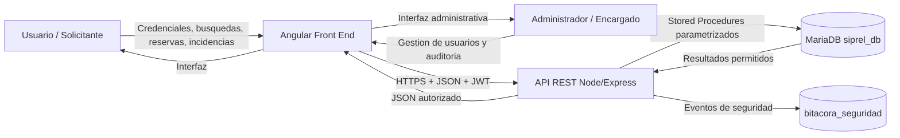

# Diagrama de Flujo de Datos (DFD)

## Procesos principales

| Proceso | Entrada | Salida | Control principal |
|---|---|---|---|
| P1 Autenticacion | usuario/contrasena | JWT | bcrypt + rate limit |
| P2 Buscar equipos | filtro | lista de equipos | SP parametrizado |
| P3 Consultar prestamo | ID | detalle autorizado | validacion de propietario/RBAC |
| P4 Crear reserva | equipo/fechas | reserva | validacion de fechas y traslapes |
| P5 Registrar incidencia | tipo/descripcion | incidencia | validacion + salida escapada |
| P6 Administrar usuarios | datos de cuenta | alta/cambio/baja | ADMIN + bcrypt |
| P7 Auditoria | eventos internos | bitacora | acceso ADMIN |

## Activos

- Credenciales y hashes de contrasena.
- JWT de sesion.
- Datos de usuarios.
- Inventario de equipos.
- Prestamos y reservas.
- Incidencias.
- Bitacora de seguridad.

## Limites de confianza

- LT1: navegador hacia servidor web.
- LT2: servidor web hacia API.
- LT3: API hacia base de datos.
